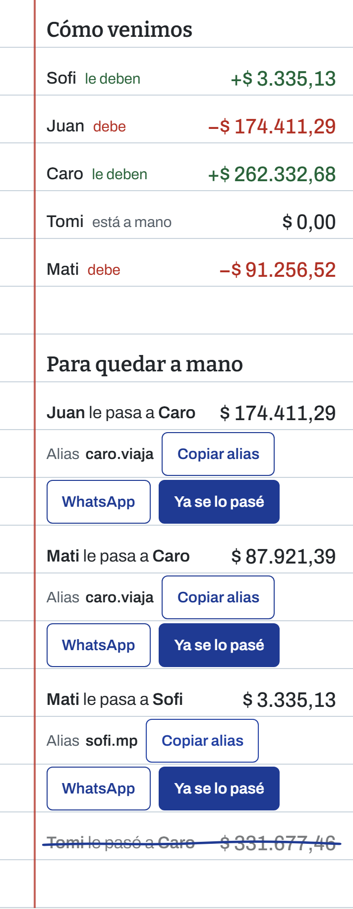
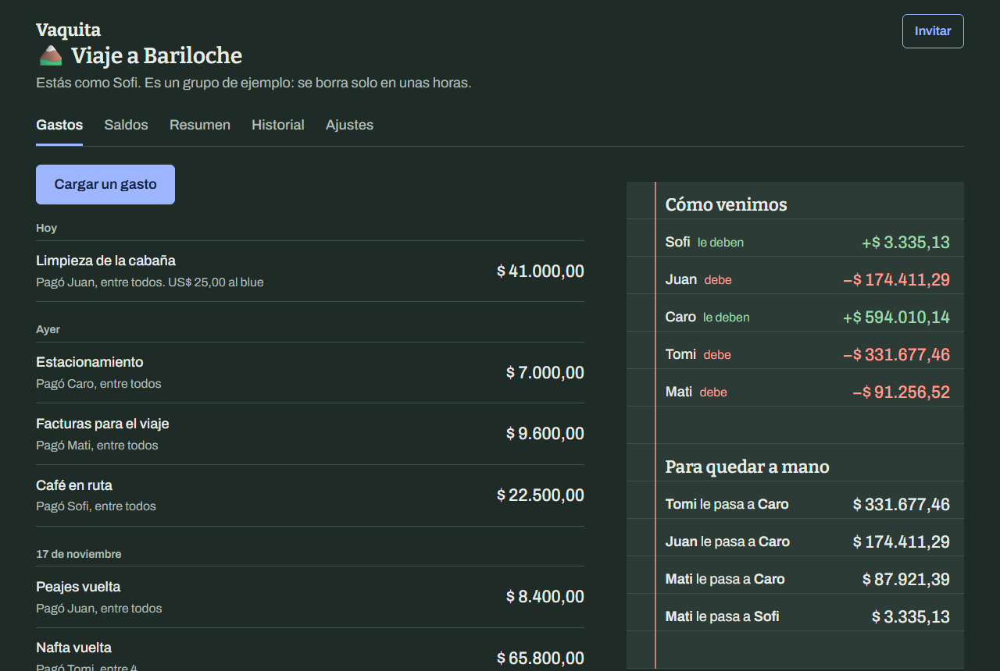

# Vaquita

**Anotá quién puso qué. Vaquita te dice quién le pasa cuánto a quién.**

Una app web para dividir gastos con amigos, compañeros de depto o de viaje, y saber al final quién le debe a quién con la menor cantidad de transferencias posible. Pensada para usarse con una mano, en la mesa, sin crear cuenta.

**Demo:** [abrir Vaquita](https://Fran951xD.github.io/vaquita/despertando/) (o directo en [vaquita-k36x.onrender.com](https://vaquita-k36x.onrender.com)) → **Ver un ejemplo** (un viaje a Bariloche con 30 gastos ya cargados). El hosting es gratis y se duerme: la primera visita puede tardar cerca de un minuto.

<p>
  
  
</p>

## Qué resuelve

En un viaje de cinco personas hay treinta gastos, algunos en dólares, algunos de unos pocos, el asado donde Juan comió doble. Al final nadie sabe cuánto le debe a quién, y las cuentas en una servilleta nunca cierran por un centavo.

Vaquita:

- Carga un gasto en menos de 10 segundos: monto, concepto, **Guardar**. Lo demás (varios pagadores, dividir por montos, porcentajes o partes, dólares, fecha) queda a un toque.
- Calcula los saldos y sugiere **cómo quedar a mano** con como mucho `personas − 1` transferencias.
- Muestra el alias para copiar, arma el mensaje de WhatsApp y, al tocar **Ya se lo pasé**, tacha la deuda en la libreta.
- Convierte dólares a pesos con la cotización del día del gasto (oficial, blue, MEP o tarjeta), que queda guardada.
- Genera los gastos fijos del mes (alquiler, expensas), guarda el historial de cambios y exporta a CSV, Excel y PDF.
- Entrás por un link secreto y elegís tu nombre. La cuenta es opcional.

## Correrlo en local (tres comandos)

Necesitás Python 3.12+ y [uv](https://docs.astral.sh/uv/).

```bash
uv sync
uv run alembic upgrade head
uv run uvicorn vaquita.web.app:crear_app --factory --reload
```

Abrí http://localhost:8000 y tocá **Ver un ejemplo**. Usa SQLite: no hay que instalar ninguna base.

```bash
uv run pytest --cov=vaquita                 # 188 tests unitarios, de propiedades y de integración
uv run playwright install chromium          # una vez
uv run pytest e2e --browser chromium        # flujos en celular y escritorio, con axe
uv run ruff check . && uv run mypy vaquita
```

## Decisiones técnicas destacadas

### La plata no usa `float`

Todo monto es un entero de centavos ([ADR-0001](docs/adr/0001-plata-en-centavos-enteros.md)). Al dividir $ 10 entre tres, los centavos que sobran se reparten con el método del mayor resto y, si hay empate, por un orden fijo: siempre da $ 3,34 + $ 3,33 + $ 3,33, y la suma es exacta. Las cotizaciones son `Decimal` y se aplican una sola vez, con redondeo bancario.

Las invariantes están probadas con [Hypothesis](https://hypothesis.readthedocs.io/) sobre miles de grupos generados al azar:

- la suma de los saldos de un grupo es siempre cero;
- después de aplicar las transferencias sugeridas, todos quedan en cero;
- las transferencias nunca son más que miembros − 1;
- ninguna de las cuatro formas de dividir pierde ni inventa un centavo.

### El algoritmo de deudas

[`vaquita/dominio/deudas.py`](vaquita/dominio/deudas.py) es Python puro, sin base ni framework. En cada vuelta, el que más debe le paga al que más le deben; cada vuelta deja a alguien en cero, así que nunca hay más de `n − 1` transferencias. No siempre es el mínimo absoluto (eso es NP-difícil): el [ADR-0003](docs/adr/0003-simplificacion-de-deudas.md) muestra un contraejemplo concreto y por qué alcanza para grupos reales. También está la opción "cada uno le paga a quien le pagó".

### Python de punta a punta

FastAPI, SQLAlchemy 2.0 tipado, Alembic, Pydantic v2 y Jinja2. Las partes dinámicas usan HTMX: guardar un gasto actualiza la lista y la libreta sin recargar, y todo funciona igual sin JavaScript ([ADR-0006](docs/adr/0006-htmx-y-render-en-servidor.md)). El JS propio son unas 80 líneas. Los gráficos son SVG armados en el servidor y el PDF sale de `fpdf2`.

### Seguridad

Link de invitación derivado con HMAC (en la base solo queda el hash), cookie de sesión firmada `HttpOnly`/`SameSite`/`Secure`, CSRF también para HTMX, CSP estricta sin `unsafe-inline`, rate limiting, contraseñas con Argon2id, y tests que intentan leer y modificar datos de otro grupo por todas las rutas ([ADR-0005](docs/adr/0005-acceso-sin-cuenta-y-seguridad.md)).

### Calidad

| | |
|---|---|
| Cobertura | 96 % el proyecto, 100 % el dominio (CI exige 85 % y 95 %) |
| Tipos | `mypy --strict` en `dominio/` y `servicios/` |
| Bases | la suite de integración corre contra SQLite y PostgreSQL en CI ([ADR-0002](docs/adr/0002-sqlite-en-local-postgres-en-produccion.md)) |
| E2E | Playwright en 390×844 y 1280×800, axe sin violaciones graves en modo claro y oscuro |
| Lighthouse (móvil, local) | portada 99 / 100 / 100 / 100 · grupo 99 / 100 / 100 / 100 |

## Diseño

La identidad sale del sobre donde se junta la plata de la vaquita: fondo de papel kraft, hojas pegadas con cinta, el grupo como un sobre con solapa y títulos enormes en letra condensada. Al saldar una deuda, un sello rojo **PAGADO** cae con un golpe sobre el papelito. De noche es un sobre manila oscuro. Los montos van en cifras tabulares con signo y palabra ("le deben", "debe") para no depender del color. Una sola familia tipográfica, Archivo (Omnibus-Type, de Buenos Aires), servida localmente y usada con su eje de ancho. El plan está en [DISENO.md](DISENO.md) y las capturas en [docs/capturas](docs/capturas).

## Estructura

```
vaquita/
  dominio/     plata, división, saldos, deudas, cotización (puro, 100 % cubierto)
  datos/       modelos SQLAlchemy y migraciones Alembic
  servicios/   casos de uso: grupos, gastos, saldos, cotizaciones, fijos, demo, exportar
  web/         rutas FastAPI, plantillas Jinja2, estáticos, seguridad
tests/         unitarios, de propiedades y de integración con base real
e2e/           Playwright + axe
docs/adr/      decisiones de arquitectura
```

## Cómo lo construí

Lo construí con [Claude Code](https://claude.com/claude-code) como asistente. Antes de escribir código definí el alcance, las reglas de la plata y los criterios de aceptación de cada funcionalidad, y armé el plan de diseño ([DISENO.md](DISENO.md)). Después avancé en tareas chicas: un commit por tarea, cada uno con los tests en verde, y TDD para toda la lógica de plata. Las decisiones importantes quedaron como registros de arquitectura en [docs/adr](docs/adr). Yo definí qué construir, las reglas (nada de `float`, nada de IA dentro de la app, la estética), revisé cada paso y decidí los cambios de rumbo. Claude Code escribió buena parte del código y de los tests bajo esas reglas. Los tests de integración y los e2e encontraron errores reales en el camino: por ejemplo, una cotización "1.200" se leía como 1,2. Están en el historial de commits.

## Desplegar

Render, plan gratis, con su Postgres (o Neon para una base permanente). Paso a paso en [GUIA-DESPLIEGUE.md](GUIA-DESPLIEGUE.md).

## Licencia

[MIT](LICENSE).
